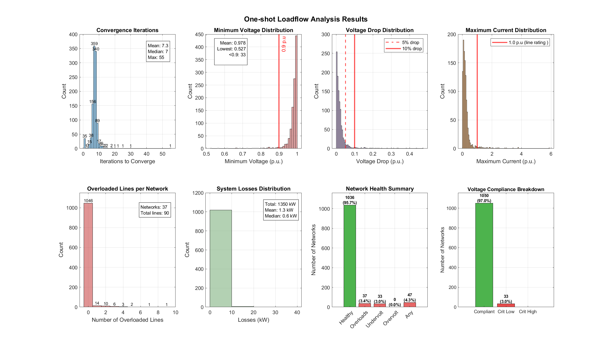

# One-shot Loadflow Analysis Results

_Combined analysis of all LV networks_

## Overall Summary

- **Networks analyzed:** 1109
- **Total load:** 81 MW

## Network Classification

### Convergence Status

- **Converged:** 1083 (97.7%) → [📋 View list](converged_networks.md)
- **Non-converged:** 26 (2.3%) → [📋 View list](non_converged_networks.md)
- **Converged load:** 79 MW

### Converged Network Health

- **✅ Healthy networks:** 1036 (95.7%) → [📋 View list](healthy_networks.md)
- **⚠️ Networks with violations:** 47 (4.3%) → [📋 View list](violation_networks.md)
  - Load affected: 5 MW (5.8% of converged load)

## Convergence Statistics

**Iterations to converge:**

- Mean: 7.3
- Median: 7
- Maximum: 55

## Voltage Quality

### Network-Level Statistics

- **Mean minimum voltage:** 0.978 p.u.
- **Lowest voltage:** 0.527 p.u.
- **Mean maximum voltage:** 1.000 p.u.
- **Highest voltage:** 1.000 p.u.

### Voltage Violations

| Severity | Threshold | Networks | Percentage |
|----------|-----------|----------|------------|
| 🔴 Critical Low | < 0.9 p.u. | 33 | 3.0% |
| 🟡 Warning Low | 0.9-0.95 p.u. | 51 | 4.7% |
| 🟡 Warning High | 1.05-1.1 p.u. | 0 | 0.0% |
| 🔴 Critical High | > 1.1 p.u. | 0 | 0.0% |

## Line Overloads

### Network-Level

- **Networks with overloaded lines:** 37 (3.4%)
- **Networks with severe overloads (>110%):** 34 (3.1%)
- **Networks with critical overloads (>120%):** 29 (2.7%)

### Line-Level

- **Total overloaded lines:** 90 (2.3% of all lines)
- **Average overloads per affected network:** 2.4

## System Losses

- **Total losses:** 1350 kW (1.7% of load)
- **Average per network:** 1.3 kW
- **Median per network:** 0.6 kW
- **Maximum per network:** 31.1 kW

## Visualizations

## Top Problem Networks

### Top 10 Networks by Voltage Drop

| Rank | Network ID | Min Voltage (p.u.) | Voltage Drop (p.u.) | Overloaded Lines |
|------|------------|-------------------|---------------------|------------------|
| 1 | 207 | 0.527 | 0.473 | 9 |
| 2 | 570 | 0.562 | 0.438 | 3 |
| 3 | 236 | 0.618 | 0.382 | 4 |
| 4 | 70995 | 0.661 | 0.339 | 7 |
| 5 | 565 | 0.668 | 0.332 | 5 |
| 6 | 5978 | 0.686 | 0.314 | 0 |
| 7 | 231 | 0.723 | 0.277 | 2 |
| 8 | 284 | 0.753 | 0.247 | 1 |
| 9 | 251 | 0.767 | 0.233 | 2 |
| 10 | 205 | 0.778 | 0.222 | 3 |

### Top 10 Networks by Line Overloads

| Rank | Network ID | Overloaded Lines | Max Current (p.u.) | Min Voltage (p.u.) |
|------|------------|------------------|-------------------|--------------------|
| 1 | 207 | 9 | 5.86 | 0.527 |
| 2 | 70995 | 7 | 1.80 | 0.661 |
| 3 | 214 | 5 | 2.85 | 0.889 |
| 4 | 565 | 5 | 3.80 | 0.668 |
| 5 | 212 | 4 | 2.37 | 0.847 |
| 6 | 236 | 4 | 2.44 | 0.618 |
| 7 | 270 | 4 | 1.68 | 0.840 |
| 8 | 179 | 3 | 1.44 | 0.896 |
| 9 | 200 | 3 | 1.57 | 0.921 |
| 10 | 205 | 3 | 2.46 | 0.778 |

### Top 10 Networks by Lowest Voltage

| Rank | Network ID | Min Voltage (p.u.) | Voltage Drop (p.u.) | Overloaded Lines |
|------|------------|-------------------|---------------------|------------------|
| 1 | 207 | 0.527 | 0.473 | 9 |
| 2 | 570 | 0.562 | 0.438 | 3 |
| 3 | 236 | 0.618 | 0.382 | 4 |
| 4 | 70995 | 0.661 | 0.339 | 7 |
| 5 | 565 | 0.668 | 0.332 | 5 |
| 6 | 5978 | 0.686 | 0.314 | 0 |
| 7 | 231 | 0.723 | 0.277 | 2 |
| 8 | 284 | 0.753 | 0.247 | 1 |
| 9 | 251 | 0.767 | 0.233 | 2 |
| 10 | 205 | 0.778 | 0.222 | 3 |

### Top 10 Networks by Highest Current

| Rank | Network ID | Max Current (p.u.) | Overloaded Lines | Min Voltage (p.u.) |
|------|------------|-------------------|------------------|--------------------|
| 1 | 207 | 5.86 | 9 | 0.527 |
| 2 | 565 | 3.80 | 5 | 0.668 |
| 3 | 570 | 3.80 | 3 | 0.562 |
| 4 | 284 | 3.42 | 1 | 0.753 |
| 5 | 558 | 2.98 | 2 | 0.878 |
| 6 | 214 | 2.85 | 5 | 0.889 |
| 7 | 205 | 2.46 | 3 | 0.778 |
| 8 | 236 | 2.44 | 4 | 0.618 |
| 9 | 212 | 2.37 | 4 | 0.847 |
| 10 | 575 | 2.30 | 3 | 0.789 |

---

*Report generated: 28-May-2026 13:11:32*
