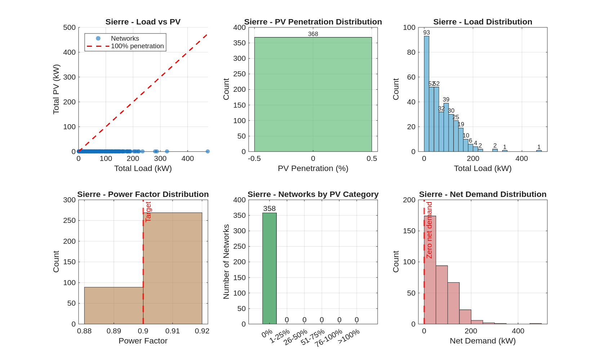

# Sierre Power Mix Analysis

## Summary Statistics

- **Networks analyzed:** 368
- **Total load:** 25432 kW
- **Total reactive power:** 12317 kVAR
- **Total PV generation:** 0 kW
- **Total net demand:** 25432 kW
- **Overall PV penetration:** 0.0%
- **Networks with PV:** 0 (0.0%)

### Power Factor

- **Average:** 0.900

## Visualizations

## PV Penetration Distribution

| Category | Networks | Percentage |
|----------|----------|------------|
| 0% | 358 | 97.3% |
| 1-25% | 0 | 0.0% |
| 26-50% | 0 | 0.0% |
| 51-75% | 0 | 0.0% |
| 76-100% | 0 | 0.0% |
| >100% | 0 | 0.0% |

## Top 10 Networks by Load

| Network ID | Load (kW) | PV (kW) | Net Demand (kW) | PV Penetration |
|------------|-----------|---------|-----------------|----------------|
| 92689 | 474 | 0 | 474 | 0.0% |
| 92633 | 325 | 0 | 325 | 0.0% |
| 92541 | 288 | 0 | 288 | 0.0% |
| 92718 | 281 | 0 | 281 | 0.0% |
| 92688 | 235 | 0 | 235 | 0.0% |
| 92480 | 221 | 0 | 221 | 0.0% |
| 92820 | 219 | 0 | 219 | 0.0% |
| 92805 | 213 | 0 | 213 | 0.0% |
| 92450 | 207 | 0 | 207 | 0.0% |
| 92650 | 203 | 0 | 203 | 0.0% |

