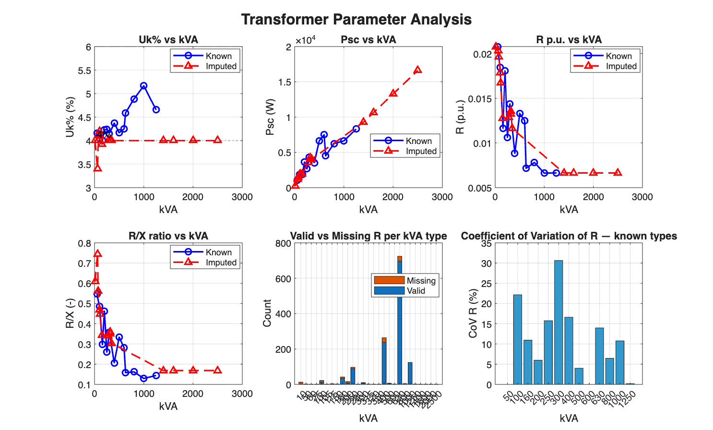

# Transformer Parameter Analysis

## Portfolio Overview

| Metric | Value |
|--------|-------|
| Total transformers | 1346 |
| Unique kVA ratings | 27 |
| Types with valid R/X pairs | 13 |
| Types with imputed R/X | 14 |
| Total missing R (0 or NaN) | 125 |
| Total missing X (0 or NaN) | 1 |
| Uk% range (known types) | 4.01 – 5.17 |
| Psc range (known types, W) | 1039 – 8304 |

## Fill Table — All kVA Types

Values used to fill missing R and X in the dataset. `measured_mean` = mean of valid entries in data. `imputed` = interpolated from neighboring known types.

| kVA | R\_pu\_fill | X\_pu\_fill | Uk% | Psc (W) | Source |
|-----|------------|------------|------|---------|--------|
| 10 | 0.020780 | 0.034179 | 4.000 | 207.8 | imputed |
| 50 | 0.020780 | 0.038019 | 4.333 | 1039.0 | measured_mean |
| 60 | 0.020310 | 0.027267 | 3.400 | 1218.6 | imputed |
| 75 | 0.019605 | 0.034866 | 4.000 | 1470.4 | imputed |
| 100 | 0.018431 | 0.037988 | 4.222 | 1843.1 | measured_mean |
| 105 | 0.017866 | 0.038011 | 4.200 | 1875.9 | imputed |
| 115 | 0.016735 | 0.037429 | 4.100 | 1924.6 | imputed |
| 150 | 0.012779 | 0.037111 | 3.925 | 1916.9 | imputed |
| 160 | 0.011649 | 0.039124 | 4.082 | 1863.8 | measured_mean |
| 200 | 0.018050 | 0.039093 | 4.306 | 3610.0 | measured_mean |
| 250 | 0.010632 | 0.041031 | 4.239 | 2658.1 | measured_mean |
| 280 | 0.012873 | 0.037872 | 4.000 | 3604.4 | imputed |
| 300 | 0.014367 | 0.040261 | 4.275 | 4310.0 | measured_mean |
| 315 | 0.013538 | 0.037640 | 4.000 | 4264.3 | imputed |
| 320 | 0.013261 | 0.037738 | 4.000 | 4243.6 | imputed |
| 350 | 0.011603 | 0.038280 | 4.000 | 4061.1 | imputed |
| 400 | 0.008840 | 0.042757 | 4.366 | 3535.8 | measured_mean |
| 500 | 0.013283 | 0.039861 | 4.202 | 6641.7 | measured_mean |
| 600 | 0.012500 | 0.044310 | 4.604 | 7500.0 | measured_mean |
| 630 | 0.007165 | 0.045270 | 4.583 | 4514.1 | measured_mean |
| 800 | 0.007812 | 0.048221 | 4.885 | 6249.3 | measured_mean |
| 1000 | 0.006626 | 0.051223 | 5.165 | 6625.6 | measured_mean |
| 1250 | 0.006643 | 0.046074 | 4.655 | 8304.0 | measured_mean |
| 1400 | 0.006643 | 0.039445 | 4.000 | 9300.5 | imputed |
| 1600 | 0.006643 | 0.039445 | 4.000 | 10629.1 | imputed |
| 2000 | 0.006643 | 0.039445 | 4.000 | 13286.4 | imputed |
| 2500 | 0.006643 | 0.039445 | 4.000 | 16608.0 | imputed |

See [Transformer Details](Transformer_details.md) for per-type validation statistics.
