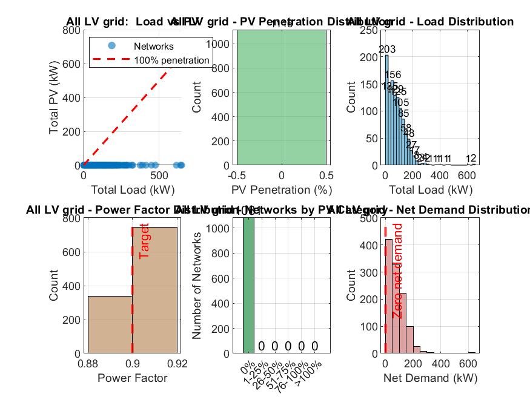

# All LV grid Power Mix Analysis

## Summary Statistics

- **Networks analyzed:** 1116
- **Total load:** 90565 kW
- **Total reactive power:** 43863 kVAR
- **Total PV generation:** 0 kW
- **Total net demand:** 90565 kW
- **Overall PV penetration:** 0.0%
- **Networks with PV:** 0 (0.0%)

### Power Factor

- **Average:** 0.900

## Visualizations

## PV Penetration Distribution

| Category | Networks | Percentage |
|----------|----------|------------|
| 0% | 1081 | 96.9% |
| 1-25% | 0 | 0.0% |
| 26-50% | 0 | 0.0% |
| 51-75% | 0 | 0.0% |
| 76-100% | 0 | 0.0% |
| >100% | 0 | 0.0% |

## Top 10 Networks by Load

| Network ID | Load (kW) | PV (kW) | Net Demand (kW) | PV Penetration |
|------------|-----------|---------|-----------------|----------------|
| 133 | 649 | 0 | 649 | 0.0% |
| 495 | 641 | 0 | 641 | 0.0% |
| 44 | 614 | 0 | 614 | 0.0% |
| 92689 | 474 | 0 | 474 | 0.0% |
| 88835 | 449 | 0 | 449 | 0.0% |
| 5494 | 413 | 0 | 413 | 0.0% |
| 89404 | 389 | 0 | 389 | 0.0% |
| 26 | 374 | 0 | 374 | 0.0% |
| 92633 | 325 | 0 | 325 | 0.0% |
| 606 | 319 | 0 | 319 | 0.0% |

