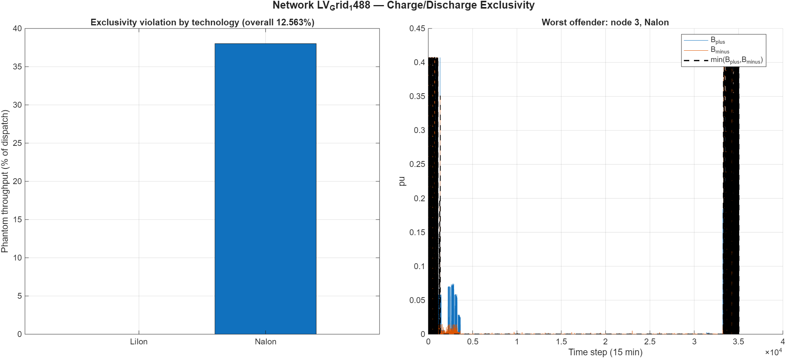

# Charge/discharge exclusivity: progress notes

## Why this started

The relaxed ESS formulation (`opts.cha_dis_bin_activate = false`, the pipeline default throughout this investigation — see the note in "Where this stands" on its current value) avoids paying for binary charge/discharge exclusivity by adding a penalty on simultaneous charge and discharge to the objective instead. Testing the objective's cost breakdown turned up two problems with that penalty:

1. It excluded `costL` (transformer/feeder loss cost) from its branch of the objective, while the solved cost report still showed a nonzero `L` — an inconsistent report.
2. It was a raw, unscaled sum: `sum(sum(0.5*(B_plus + B_minus)))`. Every other term in the objective is divided by 1000 and represents a one-time sizing cost, independent of how long the simulated horizon is. This term does neither — it grows with the number of timesteps and isn't in the same units as the rest of the objective. At `T=9,600` the two halves of the objective were already off by roughly 10x before matching units.

## The fix

Charge/discharge penalties like this are a known technique in the storage-scheduling literature — see Nazir & Almassalkhi ([arXiv:2103.07846](https://arxiv.org/abs/2103.07846)) and Prat, Lusby & Pinson ([arXiv:2508.12999](https://arxiv.org/abs/2508.12999)). The second paper gives the condition under which simultaneous charge/discharge is never optimal even with no penalty at all: a positive marginal value of stored energy, combined with round-trip efficiency below 1. Both technologies here have round-trip efficiency below 1, but the pipeline's default config (`min_loss = false`) prices nothing about the *shape* of dispatch over time — so that condition doesn't hold by construction, and the penalty is the only thing keeping the dispatch decision well-posed, not just a tiebreaker.

New formula, added to both objective branches (so `costL` is now included everywhere):

```matlab
penalty_unit_cost = cha_dis_penalty_eps * min(cE, cS);
costPenalty = penalty_unit_cost * sum(sum(B_plus + B_minus)) / T;
```

`cha_dis_penalty_eps` (new field in `sizing_cfg.json`, default `1e-3`) is a small fraction of the cheapest real per-unit technology cost. Dividing by `T` keeps the term's share of the objective the same regardless of horizon length — an average, not a growing sum.

## Checking the fix at small scale

At a fixed short horizon (`D=2`, `T=192`), sweeping `eps` from 0 to `1e-2`:

| eps | objective | E_nom (kWh) | S_conv (kVA) | phantom % | solve time |
|---|---|---|---|---|---|
| 0 | 3.2296 | 1.90 | 6.59 | 12.82% | 3.98 s |
| 1e-6 | 3.2296 | 1.90 | 6.59 | 0% | 0.57 s |
| 1e-5 | 3.2296 | 1.90 | 6.59 | 0% | 0.55 s |
| 1e-4 | 3.2296 | 1.90 | 6.59 | 0% | 1.33 s |
| 1e-3 | 3.2296 | 1.90 | 6.59 | 0% | 0.44 s |
| 1e-2 | 3.2297 | 1.90 | 6.59 | 0% | 0.31 s |

Two things stand out. At `eps=0`, the solve is both the messiest (12.8% phantom throughput) and the slowest by 10x — a sign the penalty is doing real work, not just tidying up a numerical edge case. And sizing never moves at all across five orders of magnitude of `eps` — the penalty stays safely out of the way of the real investment decision. `1e-3` sits comfortably inside this range.

## Exact vs. relaxed, D=1 to 7

Same idea, but comparing against the exact (binary) formulation instead of `eps=0`. For each `D`, the network is preprocessed once and the same operating point is reused for both formulations, so any gap comes from the relaxation itself, not from different input data. `D` stays small (1–7) because the exact formulation's binary count makes it intractable much beyond that — this is an empirical limit, not a theoretical one (MILP solve time has no polynomial guarantee).

| D | exact | relaxed | gap | exclusivity violation |
|---|---|---|---|---|
| 1 | 21.594 | 21.592 | 0.01% | 0.03% |
| 2 | 35.714 | 35.637 | 0.22% | 0.57% |
| 3 | 78.623 | 57.908 | 26.35% | 16.74% |
| 4 | 66.957 | 49.866 | 25.53% | 14.13% |
| 5 | 31.607 | 30.665 | 2.98% | 2.38% |
| 6 | 13.656 | 13.656 | 0.00% | 0.00% |
| 7 | 56.313 | 46.742 | 17.00% | 7.64% |

One clean result: the objective gap tracks the exclusivity violation almost exactly, in every single row. Whatever the relaxation gains over the exact formulation, it gains by exploiting simultaneous charge/discharge — nothing else explains the gap.

One result that needed a second look: the gap doesn't grow with `D`. D=6 matches the exact formulation perfectly; D=3 and D=4 (smaller) are the worst in the whole sweep. That's not what "gap grows with horizon" would predict.

**A caveat worth flagging plainly.** The plan was for D=1's data to be the first day of D=7's data, D=2's data to be the first two days, and so on — a clean "same data, more days" comparison. That doesn't hold. The demand generator (`generate_nodal_scenarios_4.m`, itself a placeholder for the real load-profile source) fits a Gaussian mixture model that's flagged as not converging within 100 iterations, and on a model that doesn't converge, floating-point rounding differences between runs seem to change the fit itself — even with the RNG reseeded identically before each call. So the seven `D` values are seven different demand realizations on the same network, not seven lengths of the same story. That also explains why the gap doesn't grow smoothly with `D`: it's driven by how much each specific realization's constraints reward exploiting the relaxation, not by horizon length on its own.

## Full year: does it actually run?

Yes. `D=365` (`T=35,040`, a real calendar year at 15-minute resolution), relaxed formulation, default `eps=1e-3`:

- Model: 2,487,863 variables, 2,137,451 equality constraints, 7,008,026 nonzeros
- Preprocessing: 95.3 s, solve: 105.8 s — **about 201 s total** (figures re-checked directly against the saved result; the solve time originally reported here, 107.9 s, doesn't match what's stored in the saved `.mat`'s `summary.solve_time_s` field and has been corrected to match it)
- Converged on the first iteration, linearization error 3.3e-5
- Sizing: 153.11 kWh / 183.43 kVA total (LiIon 128.67 kWh / 106.57 kVA, NaIon 24.44 kWh / 76.86 kVA)

This is the first time this pipeline has solved a genuine full year, and it does so in under four minutes with no memory problems — a direct payoff of the earlier sparse-matrix work.

## But there's a residual problem, and it's not about eps

The full-year run shows 12.56% phantom throughput — all of it in NaIon (38.02% of its own dispatch), none of it in LiIon.



The figure shows why this matters less as a widespread issue and more as a specific one: the violations sit in two narrow windows, not spread across the year.

Raising `eps` 10x (`1e-3 → 1e-2`) changed almost nothing:

| eps | objective | phantom % | NaIon violation % | violations |
|---|---|---|---|---|
| 1e-3 | 68.2769 | 12.563% | 38.020% | 388 / 70,080 |
| 1e-2 | 68.2834 | 12.564% | 38.021% | 370 / 70,080 |

A 10x price increase should move things if the problem were "penalty too weak." It didn't. So something else is going on.

**What's actually going on**: at every violation, both `B_plus` and `B_minus` for NaIon sit near or at its C-rate ceiling *at the same time* — mean utilization 4.0/5 and 3.4/5, max exactly 5.0 on both sides. The C-rate constraint bounds charge and discharge *independently* (`B_plus <= c_rate*E_nom`, `B_minus <= c_rate*E_nom` — separately, not as a pair), so a C-rate of 5 gives NaIon roughly 10x its own `E_nom` of simultaneous headroom. LiIon's C-rate of 1.1 doesn't leave that room, which is exactly why LiIon shows zero violations. Voltage was ruled out directly (it never approaches its bound during violations, same range as the rest of the year); current occasionally binds and shows a slightly elevated average during violations, a plausible secondary factor; SOE touches both its floor and ceiling during the violation set, showing some real interaction with feasibility. And nothing in the objective priced the round-trip loss this wastes — the tiny penalty was the only cost standing in the way, and it was simply outweighed by whatever the LP gained from the trick. (Correction made during review: this was originally attributed to `min_loss=false`, but `min_loss` only gates `costL`, which prices *network/transformer* losses via `P_sloss` — a completely different quantity from battery round-trip loss. Turning `min_loss` on would not have changed anything here; at the time this section was written, nothing in the codebase priced battery round-trip loss at all, regardless of `min_loss`. That gap is exactly what `opts.throughput_penalty`, introduced below, fills.)

Sizing is identical across both `eps` values tested. Whatever this is, it isn't touching the investment decision — only two narrow windows of NaIon's dispatch.

## Comparing against an older, single-node sizing script

An earlier sizing script (single node, battery arbitrage against real electricity prices) handles this differently in a few ways worth learning from:

- Its relaxed-branch penalty is `0.001 * norm(Bplus, 2) + 0.001 * norm(Bminus, 2)` — an L2 (quadratic) penalty, not the L1-style linear sum used here. A quadratic penalty's marginal cost grows with the size of the violation; a linear penalty's marginal cost is flat regardless of size. That difference maps directly onto what we found: the linear penalty drives small violations to exact zero easily, but has no extra leverage against a few large ones — which is exactly the shape of the NaIon problem.
- It prices real electricity import/export directly in the objective. That gives dispatch shape genuine economic value on its own, which is closer to the literature's sufficient condition for avoiding simultaneous charge/discharge without needing a penalty at all. This pipeline's default (`min_loss=false`) doesn't price dispatch shape at all — which is arguably the deeper reason the penalty has to do all the work here.
- Its exact/binary branch uses `1/eps = 1e6` as the Big-M — an arbitrary constant, not tied to any real bound. This pipeline's Big-M (`kP*Smax`) is the actual converter rating, which is better practice regardless of the exclusivity question.
- It has a bug in its own violation-count message (missing parentheses collapse the count expression to something else), though the warning trigger itself is correct.
- It has no cyclic SOE boundary at all, where this pipeline enforces one across the *entire* horizon — different tradeoffs, not something to fix here.

The quadratic-penalty idea from the old script looked like the most promising lead, so it was worth testing directly. It was — and it's ruled out: 39x slower for no improvement, with the specific reason (Gurobi presolve, not the underlying math) fully understood. See [ch-dis-quadratic-penalty-test.md](ch-dis-quadratic-penalty-test.md) for the full test (small-scale calibration, the full-year negative result, and why it was so slow); that path turned out to be unnecessary anyway, since the fix below solved the residual violation without touching the penalty's shape at all.

## Pricing the round-trip loss directly

Everything above treats the exclusivity penalty as the only lever. There's a second one: price the round-trip loss itself. `solve_ess_milp_v2.m` already knows the efficiency of every technology (`eta_ch`, `eta_dis`) — it uses them to evolve SOE — but nothing in the objective ever charges for the energy those efficiencies say is lost. A new flag, `opts.throughput_penalty`, adds that cost directly:

```matlab
loss_inst = Ts * ( (1 - eta_ch(j)) * B_plus(Idx,j) + (1/eta_dis(j) - 1) * B_minus(Idx,j) );
```

Charging power delivers only `eta_ch * B_plus` to the battery; the rest, `(1-eta_ch)*B_plus`, is lost. Discharging power draws `B_minus/eta_dis` from the battery to deliver `B_minus` to the grid; the extra, `(1/eta_dis - 1)*B_minus`, is lost too. Summed over the horizon and priced at the same CHF/kWh rate already used for network losses (`cfg.economics.cThroughputLoss`, off by default — price `0.0` — until explicitly set), this is a real operating cost, not a regularizer, so it's added to `sol.costs.total` alongside `costE`/`costS`/`costI`/`costL`/`costCurt` — unlike the exclusivity penalty, which stays a diagnostic-only term excluded from `.total`.

## Confirming the mechanism: it's not really about C-rate

The full-year finding above pinned the residual violation on NaIon's high C-rate (5 at the time). That explanation turned out to be incomplete. Testing again with NaIon's C-rate lowered to 0.1 — low enough that the solver picks LiIon exclusively, the same "safe," low-C-rate technology that showed *zero* violations in the full-year run — the same exploit still shows up, on LiIon this time:

Same columns, same rows, in both tables below, so the only thing that differs between them is whether round-trip loss is priced — that's what makes them directly comparable rather than two unrelated snapshots.

**Table A — `throughput_penalty` OFF (round-trip loss unpriced, the pipeline's current default):**

| D | Formulation | E_nom (kWh) | S_conv (kVA) | Objective (k CHF) | Penalty cost (CHF) | Phantom % | Max violation (kW) | Clean? |
|---|---|---|---|---|---|---|---|---|
| 1 | exact | 70.54 | 79.18 | 33.0795 | 0.00 | 0% | 0.0 | yes |
| 1 | relaxed | 70.54 | 79.18 | 33.0797 | 0.26 | 0% | 0.0 | yes |
| 2 | exact | 159.88 | 179.46 | 69.9091 | 0.00 | 0% | 0.0 | yes |
| 2 | relaxed | 159.88 | 179.46 | 69.9093 | 0.28 | 0% | 0.0 | yes |
| 3 | exact | 193.34 | 182.59 | 80.2616 | 0.00 | 0% | 0.0 | yes |
| 3 | relaxed | **168.77** | 182.59 | 72.8900 | 1.55 | **10.4%** | **73.9** | **no** |
| 4 | exact | 174.65 | 183.23 | 74.7187 | 0.00 | 0% | 0.0 | yes |
| 4 | relaxed | **163.24** | 183.23 | 71.2952 | 1.03 | **5.4%** | **74.9** | **no** |
| 5 | exact | 117.11 | 131.45 | 52.2787 | 0.00 | 0% | 0.0 | yes |
| 5 | relaxed | 117.11 | 131.45 | 52.2790 | 0.31 | 0% | 0.0 | yes |
| 6 | exact | 55.69 | 62.51 | 24.9569 | 0.00 | 0% | 0.0 | yes |
| 6 | relaxed | 55.69 | 62.51 | 24.9570 | 0.12 | 0% | 0.0 | yes |
| 7 | exact | 149.87 | 168.22 | 65.7835 | 0.00 | 0% | 0.0 | yes |
| 7 | relaxed | 149.87 | 168.22 | 65.7842 | 0.63 | 0% | 0.0 | yes |

**Table B — `throughput_penalty` ON (round-trip loss priced via `cfg.economics.cThroughputLoss`):**

| D | Formulation | E_nom (kWh) | S_conv (kVA) | Objective (k CHF) | Penalty cost (CHF) | BESS loss cost (CHF) | Phantom % | Clean? |
|---|---|---|---|---|---|---|---|---|
| 1 | exact | 70.54 | 79.18 | 38.3677 | 0.00 | 5,288.25 | 0% | yes |
| 1 | relaxed | 70.54 | 79.18 | 38.3680 | 0.26 | 5,288.25 | 0% | yes |
| 2 | exact | 159.88 | 179.46 | 81.3033 | 0.00 | 11,394.21 | 0% | yes |
| 2 | relaxed | 159.88 | 179.46 | 81.3036 | 0.28 | 11,394.21 | 0% | yes |
| 3 | exact | 193.34 | 182.59 | 158.6029 | 0.00 | 78,341.25 | 0% | yes |
| 3 | relaxed | 193.34 | 182.59 | 158.6041 | 1.26 | 78,341.25 | 0% | yes |
| 4 | exact | 174.65 | 183.23 | 151.8916 | 0.00 | 77,173.16 | 0% | yes |
| 4 | relaxed | 174.65 | 183.23 | 151.8926 | 0.93 | 77,173.16 | 0% | yes |
| 5 | exact | 117.11 | 131.45 | 83.9169 | 0.00 | 31,638.16 | 0% | yes |
| 5 | relaxed | 117.11 | 131.45 | 83.9172 | 0.31 | 31,638.16 | 0% | yes |
| 6 | exact | 55.69 | 62.51 | 40.2588 | 0.00 | 15,301.97 | 0% | yes |
| 6 | relaxed | 55.69 | 62.51 | 40.2590 | 0.12 | 15,301.97 | 0% | yes |
| 7 | exact | 149.87 | 168.22 | 156.4889 | 0.00 | 90,705.41 | 0% | yes |
| 7 | relaxed | 149.87 | 168.22 | 156.4896 | 0.63 | 90,705.41 | 0% | yes |

Read side by side, the comparison is direct: in Table A, D=3 and D=4 are the only rows where `E_nom` drops between exact and relaxed, and they're exactly the rows with nonzero phantom % and a nonzero max violation. Their objective gaps are real, not noise: 9.2% at D=3 (80.2616 vs. 72.8900), 4.6% at D=4 (74.7187 vs. 71.2952) — every other row in Table A is within 0.001%, so these two stand out clearly. In Table B, every relaxed `E_nom` matches its exact row, every phantom % is 0%, and the objective gap collapses to 0.0003-0.0008% across all seven days — at or below Gurobi's own MIPGap tolerance (1%, set in `solve_ess_milp_v2.m`), i.e. noise. The capacity gap doesn't move to somewhere else when loss pricing is turned on — it just closes.

Two things stand out immediately in the sizing comparison. First, the violation is intermittent, not universal — five of seven days come back completely clean even without loss pricing, so this isn't "LiIon always does this," it's realization-specific (consistent with the earlier finding that the seven `D` values are independent demand draws, not a nested horizon sweep). Second, in both violating cases, the relaxed formulation installs *less* capacity than the exact ground truth — and turning on `throughput_penalty` closes the gap to the fourth decimal place, at the same time as it drives the violation to exactly zero.

Pulling the raw dispatch at the violating node confirmed why. At nearly every violating timestep, `B_plus` and `B_minus` are both pinned at the C-rate ceiling *simultaneously* (74.50 kW = 1.1 × 67.72 kWh installed), with their net difference near zero — and the SOE trajectory reconstructed from the dispatch peaks at exactly the installed `E_nom`, not below it. That's the mechanism: the grid only ever sees the *net* `B_plus - B_minus` — voltage, current, and slack power all depend on that difference alone (see `delta_P` in `solve_ess_milp_v2.m`), never on `B_plus`/`B_minus` individually. But the SOE recursion does depend on them individually, through efficiency: `SOE(t) = SOE(t-1) + Ts*(eta_ch*B_plus(t) - B_minus(t)/eta_dis)`. Adding an equal amount to both, at zero net dispatch, still shifts SOE by `Ts * delta * (eta_ch - 1/eta_dis)` — always negative for a real (lossy) battery. So simultaneous charge/discharge is a free SOE-bleed valve: invisible to the grid, uncosted when nothing prices round-trip loss, and useful for shaving a demand profile's SOE peak down to fit inside a smaller installed `E_nom` than the true profile needs. The LP pays a trivial linear penalty (~1.55 CHF) to dodge capex that would otherwise cost far more.

This means the earlier explanation had the right symptom but the wrong cause. C-rate isn't what enables the exploit — it only changes how much phantom throughput is available per unit of installed capacity (a looser C-rate ceiling gives more room to bleed SOE per pu of `E_nom`, so a high-C-rate technology can run the trick cheaper and more often). The actual root cause, now confirmed on both a high-C-rate technology (NaIon, C-rate 5) and a low-C-rate one (LiIon, C-rate 1.1), is that round-trip loss goes unpriced by default. `throughput_penalty` fixes that directly, and empirically it works exactly as the literature predicts (Prat, Lusby & Pinson's condition — positive marginal value of energy plus `eta_rt < 1` — is enough to prevent simultaneous charge/discharge without any penalty at all): every `throughput_penalty=1` run in the sweep above is completely clean, with sizing matching the exact formulation almost exactly, not just approximately.

One secondary effect worth noting: at D=6, `curr_error` shifts slightly between `throughput_penalty=0` and `=1` even though installed `E_nom` is identical in both. Pricing losses doesn't just stop the exploit — it also nudges the ordinary dispatch shape toward less unnecessary cycling in general, which is the expected behavior of a genuine loss cost, not an artifact.

*(Note on reproducing the full-year numbers above: NaIon's C-rate has since been lowered from 5 to 0.1 during this investigation, so a fresh full-year run today would pick LiIon by default rather than reproducing the original NaIon-specific figures. The full-year section is left as-is as a historical record of what was actually run.)*

## Where this stood, before the next correction (see the follow-up section below)

- The linear penalty fix is validated, in production, and correctly scoped: it fixed the original bug (unscaled, objective-swamping term) and does not affect sizing decisions at any horizon tested.
- The quadratic penalty is ruled out — see [ch-dis-quadratic-penalty-test.md](ch-dis-quadratic-penalty-test.md) for the full test and the still-open question about Gurobi presolve parameters.
- The residual violation is understood now, not just observed: it's a free SOE-bleed valve created by unpriced round-trip loss, confirmed on both a high-C-rate (NaIon) and low-C-rate (LiIon) technology. C-rate changes how cheap the exploit is, not whether it exists.
- ~~`opts.throughput_penalty`, which prices round-trip loss directly, closes the loophole empirically wherever it was tested~~ — **this turned out to be wrong; see "A second correction" below.** It worked in every test run so far only because of a second, separate bug (the annualization scaling issue) that made the price far larger than intended. Once that bug was fixed, the same lever stopped working. Left here, struck through, so the reasoning trail stays honest rather than quietly rewritten.
- Worth remembering going forward: any technology with a high C-rate relative to its round-trip efficiency gets *more* of this exploit for cheaper, but every technology with round-trip loss below 1 is a candidate for it while `throughput_penalty` stays off. Worth turning it on, or at least checking for it, whenever a new technology is added to the portfolio.
- **Environment note**: `util/sizing_cfg.json`'s `flags.cha_dis_bin_activate` is currently `true` in the repo — every relaxed-vs-exact comparison in this document was run with it explicitly overridden to `false` per test case (that's the whole point of the comparison), so none of the findings above depend on the file's own current value. But if this file is read later as a description of "what the pipeline does by default," check that flag's live value first rather than trusting the sentence at the top of this document, which describes the state at the time of writing, not necessarily now.

## A second correction: the "fix" was hiding a scaling bug, and the real fix isn't finished

Everything above this line was written believing the story was basically closed. It wasn't. Here's what happened next, explained from scratch — no assumed familiarity with anything above.

### The question that started this

Three costs in the model — the network-loss cost, the curtailment cost, and the round-trip-loss cost described above — all work the same way: add up something that happened over the whole simulated period, then multiply by `365 × 15` to turn "whatever we just simulated" into "a full year, repeated for the technology's 15-year expected life." That multiplication is only correct if what you simulated *was* exactly one day. If you simulate more than one day — say, a week — the formula was still multiplying by the same fixed `365`, without ever dividing by how many days were actually simulated first. So a week's worth of real activity was being counted, then blown up as if it were only one day's worth, repeated 365 times — overstating the true annual cost by roughly a factor of however many days were simulated.

This is a genuine bug, independent of anything else in this document, and it needed fixing regardless of what else it turned out to affect.

### Why fixing it undid the earlier "solution"

It turned out this bug was the *entire reason* the round-trip-loss fee (`opts.throughput_penalty`, described above) appeared to work. The fee's job is to make "pretend to charge and discharge at once" (described in this document's earlier sections as the core exploit) too expensive to be worth doing. Once the scaling bug was corrected — so the fee no longer over-counted multi-day tests as if they were single days — the fee shrank back down to its honestly-intended size. And at that honest size, it turned out to be too small to change the answer at all. Repeating the earlier test that had shown a clean result: with the fee at its correct size, the result was now **identical** to having no fee at all — same battery size chosen, same amount of cheating, right down to the decimal. The fee wasn't weaker; it simply wasn't doing anything anymore, because it had never really been strong enough — the scaling bug had just been accidentally propping it up.

The honest conclusion: `0.15 CHF per kWh` (the fee's price, borrowed from an unrelated electricity rate elsewhere in the model, not something calibrated for this purpose) is too cheap to deter the exploit on its own.

### A different idea: block it directly instead of pricing it

Charging and discharging are each already limited by the technology's "C-rate" — a speed rating saying how fast a battery can push power in or out, relative to its size (a bigger battery, or a technology with a higher C-rate, can move power faster). The model checked this speed limit for charging and discharging **separately** — meaning, at any instant, the model could push the charging speed limit *and* the discharging speed limit at the same time, using both to their fullest simultaneously. That's exactly the shape of the cheat.

The fix tried: add one more rule saying charging speed *plus* discharging speed, combined, cannot exceed that same speed limit. Crucially, this doesn't restrict a real battery at all — if a battery is only discharging (which is what real, honest operation looks like), this new combined rule says exactly the same thing as the discharging rule already did. It only ever restricts the moment both are happening at once, which is never a legitimate thing to want.

### What actually happened when this was tested

Not what was expected. The prediction was that this would cut the *size* of any cheating roughly in half, since the combined speed budget is now half of what it used to be. Testing on a single specific case, though, showed the cheating barely shrank at all (from 10.4% down to 10.36% of the battery's activity — basically no change) when it did happen. What changed instead was **how often** it happened at all: out of 15 fresh test cases, none of them tried to cheat, versus every comparable case tried before this rule existed.

The explanation: this new rule limits the *instant* speed of combined charging+discharging, but it doesn't limit the *total amount* over the whole day. If the model has a reason to want a certain total amount of "pretend churn," it can just spread that same total across more, smaller moments throughout the day instead of doing it all at once — the rule doesn't stop that. So it turns out the rule mostly changes whether it's *worth bothering* on a given day (fewer days clear that bar now), not how much churn a determined case can still extract.

### The real, honest number: tested on 40 independent days

A single test case, or even 15, isn't a reliable estimate — each simulated day is randomly generated, and (a separate, already-known issue) that generator isn't even perfectly reproducible from one run to the next. So the fair test is a larger batch: 40 independent, freshly-generated single days, each checked with the new speed-limit rule in place, and — for any that still cheated — checked again with the round-trip-loss fee also turned on.

Results:
- **9 out of 40 days (22.5%) still cheated, even with the new rule in place.** A real improvement over "every day cheated" before the rule existed, but far from solved — roughly 1 in 4-5 simulated days would still show the problem.
- **All 9 of those cheating days were still cheating with the fee added on top — 9 out of 9.** The fee, at its current (correctly-scaled) price, made no difference to any case that got past the speed-limit rule. This matches the earlier finding exactly: this price is simply too low to matter, with or without the rule.

### Where this actually stands, honestly, right now

- The scaling bug is real and is now fixed, in both solver files. This was necessary regardless of anything else — it was silently overstating three different real costs (not just the one this document is about) for any simulation longer than a single day.
- The round-trip-loss fee, at its current price, does not prevent the cheating. The earlier claim that it did was based on a result that only held because of the (now-fixed) scaling bug.
- The new combined-speed-limit rule is a genuine, free improvement — it costs nothing, doesn't restrict any legitimate use of the battery, and cut the frequency of the problem from "essentially always" to about 1 in 4-5 days in a same-condition test.
- That's not good enough on its own for something meant to run unattended across a full year (365 days) without checking — at a 22.5% daily rate, a full year would likely show the problem on somewhere around 80 days, going purely by this sampled rate (not yet directly confirmed on an actual full-year run).
- Two honest paths forward, neither tried yet: (1) figure out what price the fee would actually need to be to matter — with real data now, not a guess — or (2) look for a second, different structural rule alongside this one, since one rule alone wasn't enough. Both are open questions for next time, not decided tonight.
